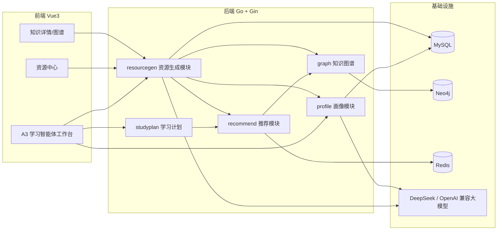
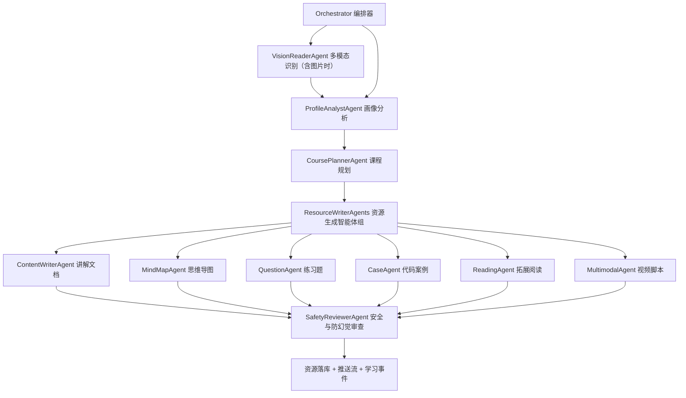
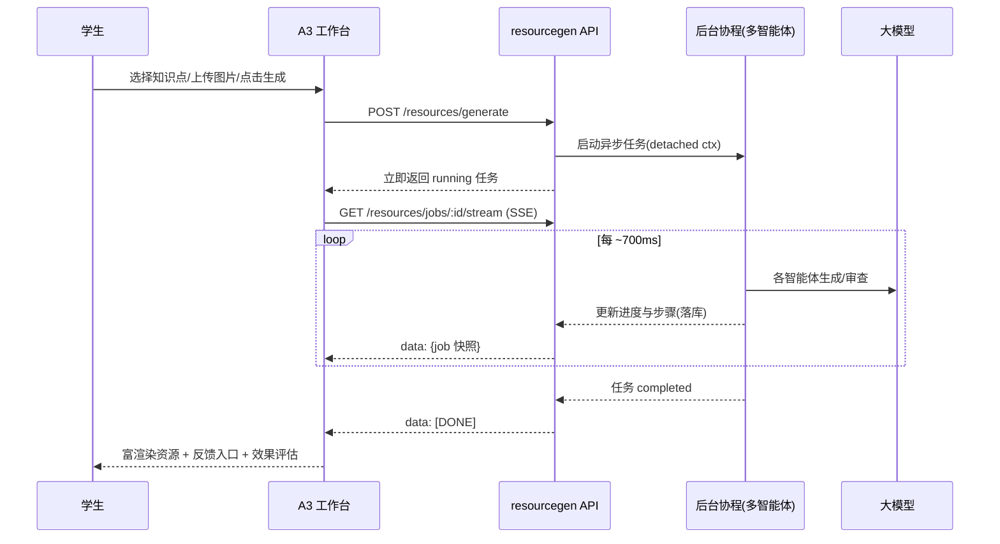
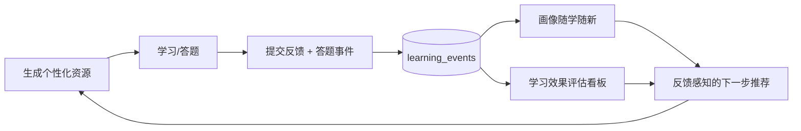

# A3 多智能体个性化资源生成 —— 架构与提交材料

> 配套文档：`a3-implemented-features-summary.md`（功能清单）、`ai-tools-and-licenses.md`（开源与 AI 工具说明）、`china-software-cup-a3-problem.md`（赛题原文）。
> 本文用于初赛提交材料：多智能体协同框架图、资源生成流程图、学生画像维度说明、五类资源样例与防幻觉/内容安全说明。

## 一、系统总体架构

## 二、多智能体协同框架

资源生成由 `resourcegen` 模块编排，多个角色智能体按序协作，过程对前端可见（步骤状态 + 进度 + SSE 流式推送）。

| 智能体 | 职责 | 输入 | 输出 |
| --- | --- | --- | --- |
| Orchestrator | 流程编排、进度推进、失败兜底 | 生成请求 | 任务状态机 |
| VisionReaderAgent | 读取上传图片，生成文字摘要 | 题图/笔记/教材页 | 视觉摘要（注入后续上下文）|
| ProfileAnalystAgent | 读取六维画像与学习目标 | 学生画像 | 生成需求 |
| CoursePlannerAgent | 结合知识图谱与推荐路径定知识点与顺序 | 图谱、推荐路径 | 学习范围与顺序 |
| ResourceWriterAgents | 并发生成多类资源 | 上下文 + 大模型 | 各类资源正文 |
| SafetyReviewerAgent | 事实性/防幻觉/敏感/格式/教学适配审查 | 资源正文 | 审查报告 |

## 三、资源生成流程（异步 + 流式）

## 四、对话式学生画像（六维）

学生用一段自然语言描述学习情况，系统抽取 6 个结构化维度，每维含维度值、置信度、证据，并随学习行为更新（随学随新）。

| 维度 key | 名称 | 含义 |
| --- | --- | --- |
| knowledge_foundation | 知识基础 | 已掌握内容与薄弱点 |
| learning_goal | 学习目标 | 目标方向与诉求 |
| learning_progress | 学习进度 | 当前所处阶段与近期完成 |
| cognitive_style | 认知风格 | 项目驱动 / 视觉结构 / 理论优先等 |
| error_preference | 易错点偏好 | 常见错误与需强化的提醒形式 |
| resource_preference | 资源偏好 | 偏好的资源类型 |

> 更新触发：资源生成、资源浏览、资源反馈、练习答题等行为写入 `learning_events`，`POST /api/profile/refresh` 据此刷新维度。

## 五、五类资源样例

1. **课程讲解文档（Markdown）**：知识点定义、原理、要点、示例、小结。
2. **知识点思维导图（Mermaid mindmap）**：中心主题 + 分支知识结构，前端可渲染。
3. **练习题目**：单选/简答，含答案与易错解析；并提供结构化互动练习（`POST /resources/quiz`）支持在线答题与效果回写。
4. **代码实操案例**：实验目标、步骤、可运行代码片段、运行说明与思考题。
5. **拓展阅读材料**：延伸主题、阅读理由与学习路径建议（来源标注，避免编造链接）。

> 加分项：多模态短视频/动画讲解脚本（分镜 + 旁白 + 素材提示）。

## 六、防幻觉与内容安全

- **生成约束**：每个资源写作智能体的系统提示词都附加防幻觉规则——只围绕给定知识点与上下文生成、不编造事实/数据/人名/论文/链接、不确定内容标注“需进一步核实”。
- **可解释依据**：资源详情展示依据来源（知识点、课程、生成智能体、个性化依据、任务编号、安全机制）。
- **安全审查智能体**：`SafetyReviewerAgent` 对资源做事实性/防幻觉、敏感与违规过滤、格式完整性、教学适配性检查，输出状态、分数、风险与建议；评分过低自动判为阻断。
- **离线兜底**：大模型不可用时回退本地模板，保证演示可用且不产生不可控内容。
- **隐私边界**：图片仅作为本次生成的多模态输入，不长期留存原图于第三方。

## 七、学习效果评估闭环

- 效果评估端点：`GET /api/resources/effect-summary`（生成数、覆盖知识点、完成率、平均评分、有帮助率、难度分布、近期行为与文字洞察）。
- 互动练习：`POST /api/resources/quiz` 出结构化单选题，答题结果以 `practice_answered` 事件回写，驱动易错点偏好与效果评估更新。
